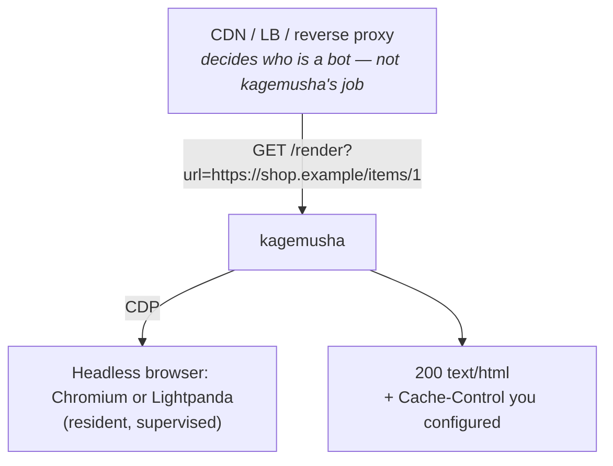

# kagemusha

**A batteries-included dynamic rendering server for SPAs.**
Hand crawlers and link-preview bots a rendered HTML *body double* of your JavaScript app, while real users keep getting the SPA. (*Kagemusha* is Japanese for a warlord's body double.)

kagemusha owns a headless browser, renders the page on request, and returns the HTML with an explicit caching contract. It is built from the post-mortem of running the (now EOL) `prerender` OSS server in production for years: every failure mode we hit has a design-level answer here.



## Why another one?

| | prerender (OSS, EOL) | Rendertron | browserless | kagemusha |
|---|---|---|---|---|
| Maintained | no | no (archived 2022) | yes (SSPL-ish license) | yes |
| Single-flight for bot bursts | no | no | no | **built in** |
| Explicit completion signal | partial | no | n/a | **first-class** |
| Response header contract | copies upstream | copies upstream | n/a | **explicit, never inherited** |
| Browser supervision / worker recycling | no | no | yes | **built in** |
| Runtime footprint of the driver | Node | Node | Node | **Go, ~20 MB** |

The browser is always the elephant; the driver just has to stay out of the way and never die with it.

## Quick start

```bash
docker build -f docker/Dockerfile -t kagemusha .
docker run --rm -p 3000:3000 --shm-size=512m \
  -e KAGEMUSHA_CACHE_CONTROL="public, max-age=3600" \
  -e KAGEMUSHA_BLOCK_DOMAINS="www.googletagmanager.com,www.google-analytics.com" \
  kagemusha

curl -i "http://localhost:3000/render?url=https://example.com/"
```

Or with compose: `docker compose -f docker/compose.yaml up --build`.

### Images

| Image | Base | Engine | Size |
|---|---|---|---|
| `kagemusha:chrome` (default) | distroless (no shell) | chrome-headless-shell | 348 MB |
| `kagemusha:lightpanda` | distroless (no shell) | Lightpanda | 112 MB |
| `kagemusha:chrome-slim` | debian:trixie-slim | Debian Chromium | 809 MB |
| `kagemusha:lightpanda-slim` | debian:trixie-slim | Lightpanda | 167 MB |

Use the distroless images in production; the `-slim` ones add a shell for debugging. `docker/Dockerfile` builds the distroless images, `docker/Dockerfile.slim` the slim ones (`--build-arg ENGINE=chrome|lightpanda`). Container health checks can run `kagemusha healthcheck` (it probes `/healthz`), as there is no shell or curl in distroless. See [docs/engines.md](docs/engines.md) for the comparison.

## How it works

1. **HTTP layer** accepts `GET /render?url=…` (or the prerender-compatible `GET /https://host/path`) and validates the target.
2. **Flow control** collapses identical in-flight URLs into one render (single-flight), caps concurrency (`KAGEMUSHA_MAX_CONCURRENT`), and queues the rest FIFO with a deadline (`KAGEMUSHA_QUEUE_TIMEOUT_MS` → `503` when exceeded). A client that disconnects does not cancel the render; followers still get the result.
3. **Render engine** creates a disposable browser context per render, optionally blocks/allows request domains, navigates, and waits for completion:
   - `window.prerenderReady === true` (first-class; set it from your app when the page is done), else
   - network idle for `KAGEMUSHA_IDLE_QUIET_MS` after `load`, else
   - the absolute limit `KAGEMUSHA_PAGE_TIMEOUT_MS` (returns the partial DOM, marked `X-Kagemusha-Trigger: timeout`).
   The response status is the HTTP status of the page itself (a `401`/`404`/`5xx` is passed through, never turned into a `200`). A page served as `200` may declare another status with `<meta name="prerender-status-code" content="404">`.
4. **Response contract**: only `200` HTML carries your `KAGEMUSHA_CACHE_CONTROL`; anything else is `Cache-Control: no-store`. Upstream page headers are never copied.
5. **Lifecycle**: a supervisor owns the browser process. It restarts it when the watchdog sees it unresponsive, on a schedule, and the worker itself exits gracefully after N renders or T hours so leaks never mature. Exit code `0` = planned recycle, `1` = crash. `/healthz` reports the real browser state and does not consume a render slot.

Every wait has a deadline. A dead browser is a failed render, never a dead process.

## Endpoints

| Method / path | Description |
|---|---|
| `GET /render?url=<absolute URL>` | Render and return HTML |
| `GET /https://host/path` | prerender-compatible form of the above |
| `GET /healthz` | `200` when the browser answers CDP and flow control is moving, `503` otherwise |
| `GET /metrics` | Prometheus metrics ([list](docs/operations.md#metrics); `KAGEMUSHA_METRICS=off` removes it) |

Response headers: `Cache-Control` (per contract above), `X-Kagemusha-Trigger: ready|idle|timeout|redirect`, `Location` on a cross-host redirect, and with the in-process cache on, `X-Kagemusha-Cache: hit|miss` plus `Age` on hits.

## Configuration

All settings are environment variables with safe defaults.

| Variable | Default | Meaning |
|---|---|---|
| `KAGEMUSHA_ENGINE` | `chrome` | `chrome` or `lightpanda` (must match the image you built) |
| `KAGEMUSHA_ENGINE_PATH` | engine default | Path to the browser binary |
| `KAGEMUSHA_LISTEN_HOST` | – (all interfaces) | Listen address, e.g. `127.0.0.1` behind a local reverse proxy |
| `KAGEMUSHA_PORT` | `3000` | Listen port |
| `KAGEMUSHA_MAX_CONCURRENT` | `4` | Concurrent renders per worker |
| `KAGEMUSHA_QUEUE_TIMEOUT_MS` | `20000` | Max time a request waits for a slot (`503` after that). A render that started is not cut by it |
| `KAGEMUSHA_READY_FLAG` | `on` | Honor `window.prerenderReady` |
| `KAGEMUSHA_IDLE_QUIET_MS` | `3000` | Network-idle quiet window (fallback completion) |
| `KAGEMUSHA_PAGE_TIMEOUT_MS` | `30000` | Absolute render limit |
| `KAGEMUSHA_BLOCK_DOMAINS` | – | Comma-separated domains to block (subdomains included) |
| `KAGEMUSHA_ALLOW_DOMAINS` | – | If set, everything not listed is blocked |
| `KAGEMUSHA_BLOCK_RESOURCE_TYPES` | – | Resource types never fetched, e.g. `Image,Media,Font` (CDP resource types, case-insensitive; `Document` cannot be blocked). Tags stay in the HTML, so crawlers still see them |
| `KAGEMUSHA_DENY_PATHS` | – | Path prefixes answered with `404` without rendering |
| `KAGEMUSHA_CROSS_HOST_NAVIGATION` | `follow` | `redirect`: when the page moves to another host (SPA navigation or HTTP redirect), stop and answer `302` with `Location` instead of rendering the destination under the original URL |
| `KAGEMUSHA_STRIP_SCRIPTS` | `off` | Remove executable scripts and script preloads from the HTML; data scripts (`application/ld+json`, `application/json`, …) are kept |
| `KAGEMUSHA_STRIP_QUERY_PARAMS` | – | Query parameters removed before rendering and single-flight, e.g. `utm_*,fbclid,gclid` (trailing `*` matches any suffix). Match your CDN cache key |
| `KAGEMUSHA_CACHE_CONTROL` | `no-store` | `Cache-Control` for `200` HTML |
| `KAGEMUSHA_CACHE_TTL` | `0` (off) | In-process cache lifetime for `200` renders, e.g. `5m` |
| `KAGEMUSHA_CACHE_MAX_ENTRIES` | `100` | In-process cache: maximum entries (LRU) |
| `KAGEMUSHA_CACHE_MAX_MB` | `64` | In-process cache: maximum total HTML size; least recently used entries are evicted, larger pages are not cached |
| `KAGEMUSHA_WORKER_MAX_RENDERS` | `1000` | Worker exits (code 0) after this many renders (randomly up to 20% fewer, so workers do not recycle together) |
| `KAGEMUSHA_WORKER_MAX_AGE` | `6h` | Worker exits (code 0) after this age (randomly up to 20% earlier) |
| `KAGEMUSHA_BROWSER_RESTART_PERIOD` | `10m` | Planned browser restart period |
| `KAGEMUSHA_WATCHDOG_TIMEOUT_MS` | `10000` | Restart the browser after this long unresponsive |
| `KAGEMUSHA_STALL_TIMEOUT` | `5m` | `/healthz` answers `503` when every slot has been busy this long with no render starting or finishing, so the orchestrator replaces the worker. `0` disables |
| `KAGEMUSHA_TARGET_HOSTS` | – | If set, only these hosts (subdomains included) may be rendered; others get `403` |
| `KAGEMUSHA_ALLOW_PRIVATE_TARGETS` | `off` | Allow private, loopback and link-local addresses (local development only) |
| `KAGEMUSHA_FORWARD_HEADERS` | – | Incoming request headers passed on to the page, e.g. `Authorization` for a Basic-auth staging site |
| `KAGEMUSHA_FORWARD_HEADERS_HOSTS` | – | Extra hosts that also receive forwarded headers (the target's own origin always does) |
| `KAGEMUSHA_RESPONSE_HEADERS` | – | Newline-separated `Name: value` lines added to every render response, e.g. `X-Robots-Tag: noindex` |
| `KAGEMUSHA_USER_AGENT` | browser UA + ` kagemusha` | User agent the browser sends |
| `KAGEMUSHA_METRICS` | `on` | Serve `GET /metrics` |

## Security

kagemusha has **no authentication of its own**: your network and edge decide who reaches it. By itself it:

- refuses targets and page requests that resolve to private, loopback or link-local addresses (cloud metadata included), and with `KAGEMUSHA_TARGET_HOSTS` anything outside your domains;
- renders staging sites behind Basic auth without storing credentials: `KAGEMUSHA_FORWARD_HEADERS=Authorization` passes the caller's header to the target origin only, so a caller without credentials gets the site's own `401`;
- never turns an error page into a cacheable `200`, and never copies the page's headers.

Details, limitations and a single-server setup: [docs/security.md](docs/security.md).

## Operations

Route bot user agents to kagemusha at your edge (excluding its own user agent, `kagemusha`), run several small workers, and let the orchestrator replace the ones that recycle themselves. Keep `QUEUE_TIMEOUT + PAGE_TIMEOUT + 5 s` below your load balancer's idle timeout, and set `KAGEMUSHA_CACHE_CONTROL` so the CDN caches renders.

`GET /metrics` (Prometheus) and one JSON log line per request (`"msg":"request"`, with the same `outcome` values) show what happened to every request.

Routing, lifecycle, timeouts, caching, the metric list and log fields: [docs/operations.md](docs/operations.md).

## Development

```bash
make test     # unit tests with local Go
make testbase && make itest   # real-browser integration tests on both engines (Docker)
```

Commands, CI, releasing and the code layout: [docs/development.md](docs/development.md).

## Engines

- **Chromium** (default): the reference engine. The distroless image ships chrome-headless-shell, about 3× faster than Debian's full Chromium in the slim image.
- **Lightpanda**: no layout or rendering, an order of magnitude less memory. It passes the same integration contract as Chromium, but its Web API coverage is partial: **compare it with Chromium on your own pages before switching.** There is no automatic fallback between engines.

Benchmarks, how each image is built, how Lightpanda is driven (telemetry off) and how to update the pinned browsers: [docs/engines.md](docs/engines.md).

## Roadmap

- [ ] Published images on ghcr.io: four variants, `linux/amd64` and `linux/arm64`
- [ ] Automated updates for the pinned browsers (chrome-headless-shell, Lightpanda); scanners do not cover them
- [ ] Vulnerability scan of all four images in CI (today only `chrome`)
- [ ] Stale-while-revalidate for the in-process cache
- [ ] Automatic browser restart after consecutive render failures

## Status

Early. The core render path, flow control, supervision and response contract are implemented and covered by unit and real-browser tests; it has not yet carried production traffic.

## License

Apache License 2.0. See [LICENSE](LICENSE) and [NOTICE](NOTICE).
