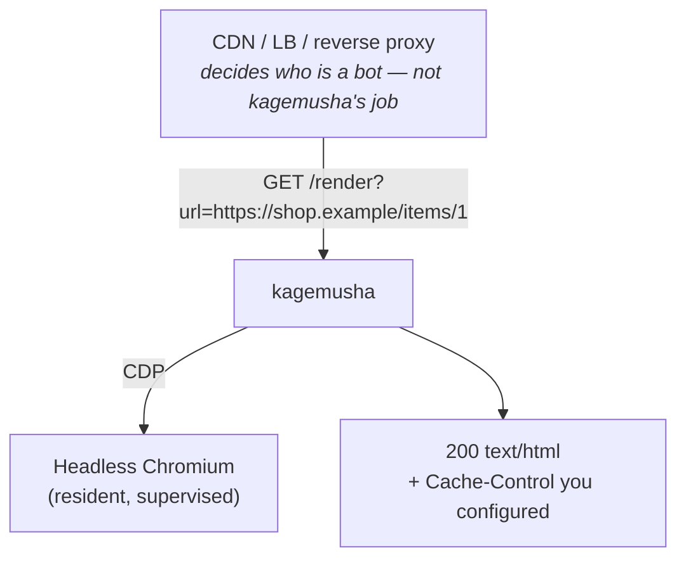

# kagemusha

**A batteries-included dynamic rendering server for SPAs.**
Hand crawlers and link-preview bots a rendered HTML *body double* of your JavaScript app, while real users keep getting the SPA. (*Kagemusha* is Japanese for a warlord's body double.)

kagemusha owns a headless browser, renders the page on request, and returns the HTML with an explicit caching contract. It is built from the post-mortem of running the (now EOL) `prerender` OSS server in production for years: every failure mode we hit has a design-level answer here.



## Why another one?

| | prerender (OSS, EOL) | Rendertron | browserless | kagemusha |
|---|---|---|---|---|
| Maintained | no | no (archived 2022) | yes (SSPL-ish license) | yes |
| Single-flight for bot bursts | no | no | no | **built in** |
| Explicit completion signal | partial | no | n/a | **first-class** |
| Response header contract | copies upstream | copies upstream | n/a | **explicit, never inherited** |
| Browser supervision / worker recycling | no | no | yes | **built in** |
| Runtime footprint of the driver | Node | Node | Node | **Go, ~20 MB** |

The browser is always the elephant; the driver just has to stay out of the way and never die with it.

## Quick start

```bash
docker build -f docker/Dockerfile -t kagemusha .
docker run --rm -p 3000:3000 --shm-size=512m \
  -e KAGEMUSHA_CACHE_CONTROL="public, max-age=3600" \
  -e KAGEMUSHA_BLOCK_DOMAINS="www.googletagmanager.com,www.google-analytics.com" \
  kagemusha

curl -i "http://localhost:3000/render?url=https://example.com/"
```

Or with compose: `docker compose -f docker/compose.yaml up --build`.

## How it works

1. **HTTP layer** accepts `GET /render?url=…` (or the prerender-compatible `GET /https://host/path`) and validates the target.
2. **Flow control** collapses identical in-flight URLs into one render (single-flight), caps concurrency (`KAGEMUSHA_MAX_CONCURRENT`), and queues the rest FIFO with a deadline (`KAGEMUSHA_QUEUE_TIMEOUT_MS` → `503` when exceeded). A client that disconnects does not cancel the render; followers still get the result.
3. **Render engine** creates a disposable browser context per render, optionally blocks/allows request domains, navigates, and waits for completion:
   - `window.prerenderReady === true` (first-class; set it from your app when the page is done), else
   - network idle for `KAGEMUSHA_IDLE_QUIET_MS` after `load`, else
   - the absolute limit `KAGEMUSHA_PAGE_TIMEOUT_MS` (returns the partial DOM, marked `X-Kagemusha-Trigger: timeout`).
   The response status is the HTTP status of the page itself (a `401`/`404`/`5xx` is passed through, never turned into a `200`). A page served as `200` may declare another status with `<meta name="prerender-status-code" content="404">`.
4. **Response contract**: only `200` HTML carries your `KAGEMUSHA_CACHE_CONTROL`; anything else is `Cache-Control: no-store`. Upstream page headers are never copied.
5. **Lifecycle**: a supervisor owns the browser process. It restarts it when the watchdog sees it unresponsive, on a schedule, and the worker itself exits gracefully after N renders or T hours so leaks never mature. Exit code `0` = planned recycle, `1` = crash. `/healthz` reports the real browser state and does not consume a render slot.

Every wait has a deadline. A dead browser is a failed render, never a dead process.

## Endpoints

| Method / path | Description |
|---|---|
| `GET /render?url=<absolute URL>` | Render and return HTML |
| `GET /https://host/path` | prerender-compatible form of the above |
| `GET /healthz` | `200` when the browser answers CDP, `503` otherwise |

Response headers: `Cache-Control` (per contract above), `X-Kagemusha-Trigger: ready|idle|timeout|redirect`, `Location` on a cross-host redirect, and with the in-process cache on, `X-Kagemusha-Cache: hit|miss` plus `Age` on hits.

## Configuration

All settings are environment variables with safe defaults.

| Variable | Default | Meaning |
|---|---|---|
| `KAGEMUSHA_ENGINE` | `chrome` | `chrome` or `lightpanda` (must match the image you built) |
| `KAGEMUSHA_ENGINE_PATH` | engine default | Path to the browser binary |
| `KAGEMUSHA_LISTEN_HOST` | – (all interfaces) | Listen address, e.g. `127.0.0.1` behind a local reverse proxy |
| `KAGEMUSHA_PORT` | `3000` | Listen port |
| `KAGEMUSHA_MAX_CONCURRENT` | `4` | Concurrent renders per worker |
| `KAGEMUSHA_QUEUE_TIMEOUT_MS` | `45000` | Max time a request waits for a slot. Keep it **below** your LB idle timeout |
| `KAGEMUSHA_READY_FLAG` | `on` | Honor `window.prerenderReady` |
| `KAGEMUSHA_IDLE_QUIET_MS` | `3000` | Network-idle quiet window (fallback completion) |
| `KAGEMUSHA_PAGE_TIMEOUT_MS` | `30000` | Absolute render limit |
| `KAGEMUSHA_BLOCK_DOMAINS` | – | Comma-separated domains to block (subdomains included) |
| `KAGEMUSHA_ALLOW_DOMAINS` | – | If set, everything not listed is blocked |
| `KAGEMUSHA_BLOCK_RESOURCE_TYPES` | – | Resource types never fetched, e.g. `Image,Media,Font` (CDP resource types, case-insensitive; `Document` cannot be blocked). Tags stay in the HTML, so crawlers still see them |
| `KAGEMUSHA_DENY_PATHS` | – | Path prefixes answered with `404` without rendering |
| `KAGEMUSHA_CROSS_HOST_NAVIGATION` | `follow` | `redirect`: when the page moves to another host (SPA navigation or HTTP redirect), stop and answer `302` with `Location` instead of rendering the destination under the original URL |
| `KAGEMUSHA_STRIP_QUERY_PARAMS` | – | Query parameters removed before rendering and single-flight, e.g. `utm_*,fbclid,gclid` (trailing `*` matches any suffix). Match your CDN cache key |
| `KAGEMUSHA_CACHE_CONTROL` | `no-store` | `Cache-Control` for `200` HTML |
| `KAGEMUSHA_CACHE_TTL` | `0` (off) | In-process cache lifetime for `200` renders, e.g. `5m` |
| `KAGEMUSHA_CACHE_MAX_ENTRIES` | `100` | In-process cache size (LRU). Memory ≈ entries × page size |
| `KAGEMUSHA_WORKER_MAX_RENDERS` | `1000` | Worker exits (code 0) after this many renders |
| `KAGEMUSHA_WORKER_MAX_AGE` | `6h` | Worker exits (code 0) after this age |
| `KAGEMUSHA_BROWSER_RESTART_PERIOD` | `10m` | Planned browser restart period |
| `KAGEMUSHA_WATCHDOG_TIMEOUT_MS` | `10000` | Restart the browser after this long unresponsive |
| `KAGEMUSHA_TARGET_HOSTS` | – | If set, only these hosts (subdomains included) may be rendered; others get `403` |
| `KAGEMUSHA_ALLOW_PRIVATE_TARGETS` | `off` | Allow private, loopback and link-local addresses (local development only) |
| `KAGEMUSHA_FORWARD_HEADERS` | – | Incoming request headers passed on to the page, e.g. `Authorization` for a Basic-auth staging site |
| `KAGEMUSHA_FORWARD_HEADERS_HOSTS` | – | Extra hosts that also receive forwarded headers (the target's own origin always does) |
| `KAGEMUSHA_RESPONSE_HEADERS` | – | Newline-separated `Name: value` lines added to every render response, e.g. `X-Robots-Tag: noindex` |
| `KAGEMUSHA_USER_AGENT` | browser UA + ` kagemusha` | User agent the browser sends |

## Security

kagemusha has **no authentication of its own**: who may reach it is decided by your network and edge. What it does by itself:

- **SSRF protection**: the target and every request the page makes (redirects included) must resolve to a public address. Cloud metadata (`169.254.169.254`), private networks and loopback are refused unless `KAGEMUSHA_ALLOW_PRIVATE_TARGETS=on`. Set `KAGEMUSHA_TARGET_HOSTS` to your own domains so it cannot be used to render anyone else's site. Limitation: WebSocket connections and DNS rebinding between the check and the browser's own lookup are not covered; keep kagemusha off networks that expose sensitive services.
- **Staging behind Basic auth**: set `KAGEMUSHA_FORWARD_HEADERS=Authorization`. kagemusha stores no credentials; it passes on what the caller sent, only to the target's origin (and `KAGEMUSHA_FORWARD_HEADERS_HOSTS`), never to third parties. A caller without credentials gets the site's own `401`, so bots cannot read your staging site through kagemusha:

  ```bash
  curl -u test:testpass -A Googlebot https://stg.example.com/   # rendered page
  curl -A Googlebot https://stg.example.com/                    # 401
  ```

  Requests with different forwarded headers are never merged by single-flight. If a CDN sits in front, make it check authentication before serving from cache. Add `KAGEMUSHA_RESPONSE_HEADERS="X-Robots-Tag: noindex"` on staging as a safety net.
- **Loop prevention**: the browser's user agent ends with ` kagemusha`. Do not route that user agent back to kagemusha at your edge.

## Deploying

kagemusha renders; **your edge decides who gets the render**. Route bot user agents (Googlebot, Bingbot, link previews, AI crawlers, …) to kagemusha and everyone else to the SPA. Typical nginx sketch:

```nginx
map $http_user_agent $is_bot {
  default 0;
  ~*kagemusha 0;   # kagemusha's own page loads (checked first)
  ~*(googlebot|bingbot|slackbot|twitterbot|facebookexternalhit|gptbot|claudebot) 1;
}
location / {
  if ($is_bot) { proxy_pass http://kagemusha:3000/render?url=$scheme://$host$request_uri; }
  try_files $uri /index.html;
}
```

Run several small workers behind a load balancer rather than one big one; the orchestrator (ECS, Kubernetes) replaces workers that recycle themselves.

On a single VPS, let the reverse proxy do Basic auth and bot routing, and keep kagemusha on loopback (`KAGEMUSHA_LISTEN_HOST=127.0.0.1`, `KAGEMUSHA_TARGET_HOSTS=example.com`). Exclude kagemusha's own user agent from the bot match so its page loads reach the SPA.

### Operational notes

- **Amplification**: one render fans out into dozens of sub-requests. Your own WAF rate limits will see kagemusha's egress IP as a burst. Use `KAGEMUSHA_BLOCK_DOMAINS` to drop analytics/ads/session-recording beacons — it also makes renders finish faster.
- **Timeouts**: `KAGEMUSHA_QUEUE_TIMEOUT_MS` + `KAGEMUSHA_PAGE_TIMEOUT_MS` should stay below the LB idle timeout, or clients disconnect before you answer.
- **Impatient preview bots** (Slack, Facebook: 5–9 s client timeouts) only need OGP tags. Serve them a lightweight endpoint upstream if full renders are slow.
- **Caching is two-layered**: the CDN is the main cache; the in-process cache (`KAGEMUSHA_CACHE_TTL`, short is enough) absorbs bots retrying right after a render. Only `200` is cached, under the same key as single-flight, so a page rendered with forwarded credentials is served only to the same credentials. Set `KAGEMUSHA_CACHE_CONTROL` deliberately; the default `no-store` means *the CDN caches nothing* until you decide otherwise.
- **/dev/shm**: Chromium needs shared memory. `--disable-dev-shm-usage` is on, but give the container `--shm-size=512m` anyway.
- **Signals**: `SIGTERM` drains in-flight renders (up to `PAGE_TIMEOUT + 5s`) and exits `0`.

## Development

The browser lives in Docker; everything else runs with your local Go toolchain.

```bash
make test        # unit tests with local Go (no browser needed)
make testbase    # one-time: build the Chromium-equipped dev image
make itest       # real-browser integration tests, source mounted (no rebuild)
make up          # run the server via compose on http://localhost:3000
make image ENGINE=chrome && make run-image   # build/run the runtime image directly
```

Typical loop: edit → `make test` → `make itest` → `make up` and `curl "http://localhost:3000/render?url=https://example.com/"`.
`docker build -f docker/Dockerfile --target test .` runs the full suite the way CI does.

Real-browser tests are mandatory in CI: mocks did not catch a single one of the production failures that shaped this design.

Layout:

```
cmd/kagemusha/        entry point, wiring, signals
internal/config/      env → Config
internal/server/      HTTP layer + response contract
internal/flow/        single-flight, concurrency cap, FIFO queue
internal/lifecycle/   supervisor (watchdog, planned restart), worker exit policy
internal/render/      engine abstraction; chrome/ = chromedp implementation
docker/               Dockerfile (ENGINE=chrome|lightpanda), compose
testdata/spa/         tiny SPAs used by integration tests
```

## Engines

- **Chromium** (default, `--build-arg ENGINE=chrome`): the reference engine. Uses only four CDP areas — Page navigation, Fetch interception, Runtime evaluation, DOM capture — plus `Browser.getVersion` for health.
- **Lightpanda** (`--build-arg ENGINE=lightpanda`, experimental): a much lighter browser that speaks CDP, but with partial DOM/Web API coverage and no layout. It graduates from experimental once the engine-comparison integration test renders the same SPA identically.

## Roadmap

- [ ] `/metrics` (Prometheus): renders, durations, queue depth, browser restarts, exit reasons
- [x] In-process LRU cache
- [ ] Stale-while-revalidate for the in-process cache
- [ ] Lightpanda launcher + engine comparison test
- [ ] Automatic browser restart after consecutive render failures
- [ ] Smaller runtime image

## Status

Early. The core render path, flow control, supervision and response contract are implemented and covered by unit and real-browser tests; it has not yet carried production traffic.

## License

Apache License 2.0. See [LICENSE](LICENSE) and [NOTICE](NOTICE).
