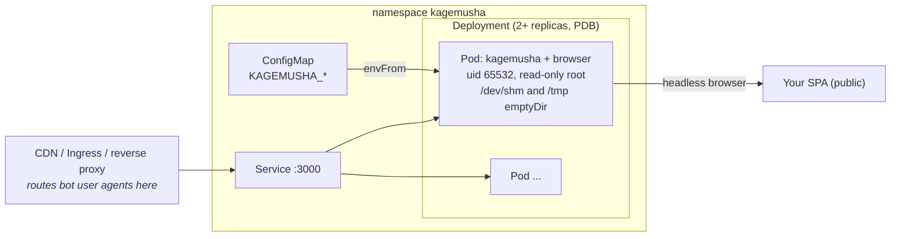

# Deployment

kagemusha is one stateless process per container. Run several small workers behind a load balancer and let the orchestrator replace the ones that recycle themselves ([operations.md](operations.md#lifecycle)).

## Docker

See the [Quick start](../README.md#quick-start) and [docker/compose.yaml](../docker/compose.yaml). Give Chromium room in `/dev/shm` (`--shm-size=512m`); the image runs as uid 65532 and works with a read-only root file system as long as `/tmp` is writable:

```bash
docker run --rm -p 3000:3000 --shm-size=512m --read-only --tmpfs /tmp --cap-drop ALL \
  -e KAGEMUSHA_TARGET_HOSTS=example.com kagemusha
```

## Kubernetes

The Helm chart is in [charts/kagemusha](../charts/kagemusha). The release workflow publishes it at `oci://ghcr.io/otaqq/charts/kagemusha` with the same version as the images (once releases are published; see the README roadmap).

```sh
cat > values.yaml <<'EOF'
env:
  KAGEMUSHA_TARGET_HOSTS: "example.com"
  KAGEMUSHA_CACHE_CONTROL: "public, max-age=3600"
  KAGEMUSHA_BLOCK_DOMAINS: "www.googletagmanager.com,www.google-analytics.com"
EOF
helm install kagemusha oci://ghcr.io/otaqq/charts/kagemusha --version <version> \
  -n kagemusha --create-namespace -f values.yaml
```

From a checkout, `helm install kagemusha charts/kagemusha -f values.yaml` does the same; set `image.tag` to a published image, since the chart in the repository is not tied to a release.



What the chart does, and why:

- **Several replicas (default 2), `RollingUpdate`, a PodDisruptionBudget (`maxUnavailable: 1`).** Workers exit on purpose after `KAGEMUSHA_WORKER_MAX_RENDERS` renders or `KAGEMUSHA_WORKER_MAX_AGE`; Kubernetes restarts the container. With one replica, every recycle is a short outage.
- **Draining (`drainDelay`, default `15s`).** Rendered into `KAGEMUSHA_DRAIN_DELAY`. On a planned exit or `SIGTERM`, `/healthz` turns `503` and the worker keeps serving for that long, so the readiness probe (every 5 s, 2 failures) takes it out of the Service before the listener closes. `terminationGracePeriodSeconds` (60) covers drain + page timeout + 5 s.
- **Restarts after a planned exit.** Kubernetes restarts any container that exits, also with code `0`, and delays restarts that come in quick succession (`CrashLoopBackOff`, from 10 s, reset after 10 minutes of running). With the default limits (1000 renders, 6 h) recycles are far apart; very low limits make each restart wait longer.
- **Configuration.** `env` holds `KAGEMUSHA_*` settings (README, *Configuration*) and becomes a ConfigMap; a change restarts the Pods (checksum annotation). `extraEnv` takes Kubernetes-style variables, `envFrom` whole ConfigMaps or Secrets. The chart fixes the port (3000, all interfaces), so `KAGEMUSHA_PORT` and `KAGEMUSHA_LISTEN_HOST` are rejected.
- **Image.** `image.engine: chrome` (default) or `lightpanda` picks the tag (`<version>` or `<version>-lightpanda`); `image.tag` overrides it.
- **Browser scratch space.** The root file system is read-only. `/dev/shm` is a memory-backed emptyDir (`shm.sizeLimit`, 512Mi; it counts toward the memory limit) and `/tmp` an emptyDir (`tmp.sizeLimit`, 256Mi) for the browser profile.
- **Probes.** A startup probe waits for the browser (up to 60 s); readiness and liveness use `/healthz`, which turns `503` when the browser stops answering, flow control stalls (`KAGEMUSHA_STALL_TIMEOUT`) or the worker drains.
- **Security.** Non-root uid 65532, read-only root, no capabilities, RuntimeDefault seccomp, no service account token. kagemusha has no authentication: route only bot traffic to it, set `KAGEMUSHA_TARGET_HOSTS`, and enable the Ingress only for networks you trust ([security.md](security.md)).
- **Resources.** Requests `500m` CPU and `512Mi`, limit `1Gi` memory, from Chromium peaking at about 340 MB on a small SPA ([engines.md](engines.md)). Measure your own pages; Lightpanda needs an order of magnitude less.
- **Scaling.** `autoscaling.enabled` adds a CPU-based HorizontalPodAutoscaler. Queue length is the better signal: scale on `kagemusha_queue_waiting` (or `kagemusha_queue_running / kagemusha_max_concurrent`) with KEDA or the Prometheus Adapter. `serviceMonitor.enabled` adds a Prometheus Operator ServiceMonitor for `GET /metrics`.

Other values: `service`, `ingress`, probes, `nodeSelector`, `tolerations`, `affinity`, `topologySpreadConstraints`, `priorityClassName`, `podAnnotations`, `podLabels` (see [values.yaml](../charts/kagemusha/values.yaml)).

Without Helm, the same objects as plain manifests: `helm template kagemusha charts/kagemusha -f values.yaml`.

### Verified behaviour

On a local kind cluster with the distroless chrome image under the chart's security context:

| Check | Result |
|---|---|
| Start and render through the Service | `200`; a host outside `KAGEMUSHA_TARGET_HOSTS` gets `403` |
| One of two Pods recycles (planned exit) while the Service is probed every 0.2 s for 60 s | `drainDelay: 15s`: 285 of 285 succeeded. `drainDelay: 0s`: 1 refused connection; requests sent straight to the exiting Pod after its exit were refused |
| `SIGTERM` during a 4 s render | The render completes with `200`; a request during the drain is rendered; `/healthz` answers `503 draining` |
| Both Pods hit a tiny render limit at the same moment | Requests fail while neither Pod is ready: draining cannot help when every replica recycles at once. The random 0–20% shortening of the limits keeps this rare; run more replicas if load is uneven |

CI (`chart-kind`) installs the chart on kind and renders through the Service on every push.
