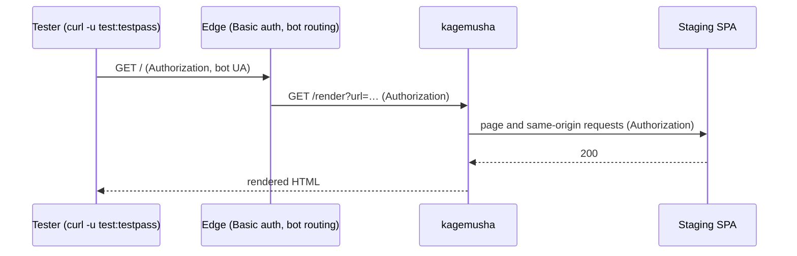

# Security

kagemusha has **no authentication of its own**. Who may reach it is decided by your network and edge (private subnet, security group, loopback behind a reverse proxy). What it guards by itself is what it fetches and what it answers.

## SSRF protection

A rendering server fetches whatever URL it is given, with the network position of the server. kagemusha refuses, by default:

- targets and **every request the page makes** — sub-resources, navigations and each redirect hop — that resolve to a non-public address: loopback, private ranges, link-local (including cloud metadata at `169.254.169.254`), carrier-grade NAT, NAT64 and other reserved ranges;
- with `KAGEMUSHA_TARGET_HOSTS` set, targets outside your own domains (subdomains included), so it cannot be used to render anyone else's site.

The target is checked before rendering (`403 target not allowed`, or `502` when the name does not resolve). Requests the page makes are checked through Fetch interception, once per host per render.

`KAGEMUSHA_ALLOW_PRIVATE_TARGETS=on` turns the address check off, for local development only.

Limitations:

- WebSocket connections are not intercepted.
- DNS rebinding between kagemusha's lookup and the browser's own lookup is not covered.

Keep kagemusha off networks that expose sensitive services, as with any component that fetches URLs.

## Staging sites behind Basic auth

Set `KAGEMUSHA_FORWARD_HEADERS=Authorization`. kagemusha stores no credentials: it passes on what the caller sent, and the site decides.



```bash
curl -u test:testpass -A Googlebot https://stg.example.com/   # rendered page
curl -A Googlebot https://stg.example.com/                    # the site's own 401
```

- Forwarded headers go **only to the target's origin** (and hosts listed in `KAGEMUSHA_FORWARD_HEADERS_HOSTS`, for an authenticated API on another host), **never to third parties** such as analytics or CDNs.
- A caller without credentials gets the site's `401`, passed through as `401` with `no-store` — bots cannot read a staging site through kagemusha.
- Requests with different forwarded headers are never merged by single-flight, and the in-process cache keys on them too, so a cached page is only served to the same credentials.
- Forwarded headers are never logged.
- If a CDN sits in front, make it check authentication **before** serving from its cache.

Credentials in environment variables (kagemusha authenticating on everyone's behalf) are deliberately not supported: anyone who can reach kagemusha could then read the site.

As a safety net on staging, add `KAGEMUSHA_RESPONSE_HEADERS="X-Robots-Tag: noindex"`: if the staging site is ever exposed by mistake, its renders still are not indexed. Headers that the response contract owns (`Cache-Control`, `Content-Type`, `Location`, `Age`, `X-Kagemusha-*`) cannot be overridden.

## Response contract

- The status is the HTTP status of the page itself; a `401`, `404` or `5xx` is never turned into a cacheable `200`. A page served as `200` may declare another status with `<meta name="prerender-status-code">`.
- Only `200` carries `KAGEMUSHA_CACHE_CONTROL`; everything else is `no-store`.
- Headers of the rendered page are never copied to the response.

## Loop prevention

The browser's user agent carries the marker `kagemusha` (Chromium: browser UA + ` kagemusha`; Lightpanda: via its UA suffix). Exclude it from the bot match at your edge, or kagemusha's own page loads are routed back to kagemusha.

## Single server (VPS) setup

Without a CDN or load balancer, let the reverse proxy do Basic auth and bot routing, and keep kagemusha on loopback:

```bash
KAGEMUSHA_LISTEN_HOST=127.0.0.1
KAGEMUSHA_TARGET_HOSTS=example.com
KAGEMUSHA_FORWARD_HEADERS=Authorization   # if the site is behind Basic auth
```

```nginx
map $http_user_agent $is_bot {
  default 0;
  ~*kagemusha 0;   # kagemusha's own page loads (checked first)
  ~*(googlebot|bingbot|slackbot|twitterbot|facebookexternalhit|gptbot|claudebot) 1;
}
server {
  auth_basic "staging";
  auth_basic_user_file /etc/nginx/htpasswd;
  location / {
    if ($is_bot) { proxy_pass http://127.0.0.1:3000/render?url=$scheme://$host$request_uri; }
    try_files $uri /index.html;
  }
}
```

nginx passes the incoming `Authorization` header to kagemusha by default, so authenticated bot tests render and unauthenticated ones get `401`.

## Images

The distroless images have no shell or package manager and run as a non-root user. Copied libraries keep their `dpkg` records so scanners see them; the browsers themselves are pinned downloads that scanners do not cover — see [Updating the pinned browsers](engines.md#updating-the-pinned-browsers).
